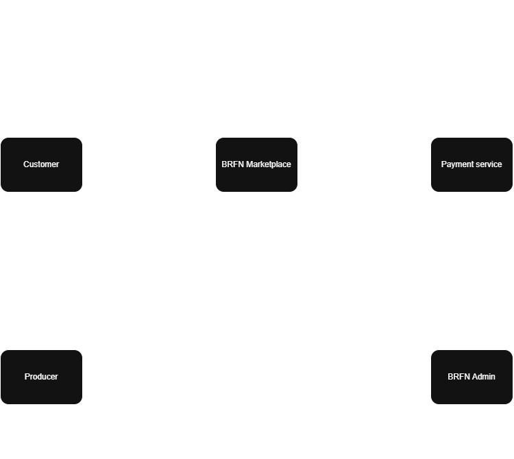

# i* Strategic Dependency Model

## Purpose

The Strategic Dependency model shows how the main people and systems involved in the Bristol Regional Food Network (BRFN) marketplace depend on one another. Each dependency has a few factors:

- The actor that needs something
- The actor expected to provide it
- The goal, task or resource being depended on

This model is based on the two main functions currently described in the group plan:

- Customer multi-vendor ordering and checkout
- Producer fulfilment and the weekly settlement

## Main actors

**Customer** – Browses products on the website, places orders and receives updates on their order

**BRFN Marketplace** – Manages orders, communicates with producers and coordinates payments and settlements

**Producer** – Manages products and availability, responds to orders and fulfils accepted orders

**Payment Service** – Processes customer payments and producer payouts. This is an external service and will likely use a simulated process.

**BRFN Administration** – Helps deal with problems such as producer non-fulfilment, disputes and settlement issues.

## Main dependencies

| Depender | Dependee | Reason | Purpose |
|---|---|---|---|
| Customer | BRFN Marketplace | Ability to browse products and place multi-vendor orders | Goal |
| Customer | BRFN Marketplace | Accurate products, prices and availability information | Resource |
| Customer | BRFN Marketplace | Order confirmations and updates | Resource |
| BRFN Marketplace | Producer | Product information and availability | Resource |
| BRFN Marketplace | Producer | Responses to order requests | Task |
| BRFN Marketplace | Producer | Fulfilment of accepted sub-orders | Task |
| BRFN Marketplace | Payment Service | Processing customer payments and returning the transaction result | Task |
| Producer | BRFN Marketplace | Accurate order details and notifications | Resource |
| BRFN Marketplace | BRFN Administrator | Help resolving disputes and other operational problems | Task |
| BRFN Administrator | BRFN Marketplace | Access to order and producer records | Resource |

## Explanation of the dependencies

Customers rely on the marketplace to find products, place orders involving more than one producer and receive clear updates. They also rely on the information displayed by the marketplace being accurate.

The marketplace relies on producers to keep product and availability information up to date, respond to order requests and fulfil the sub-orders they accept. A multi-vendor order may involve several producers, so the marketplace needs each producer to deal with their part of the order.

The marketplace also relies on the Payment Service to process customer payments and return a success or failure result. The Payment Service should likely be simulated rather than connected to live payment systems.

Producers rely on the marketplace to provide accurate order details and notifications so they can prepare the correct products. The marketplace may also rely on the BRFN Administrator to investigate non-responders, disputes, fulfilment problems or settlement issues. In turn, the administrator relies on the marketplace for access to the relevant records.

## Strategic Dependency Model Diagram

The following diagram shows the main actors involved with the BFRN marketplace and the dependencies between them.

